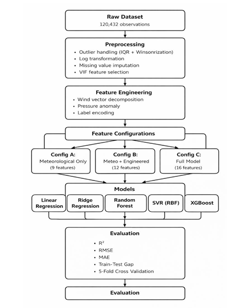

# PM2.5 Air Quality Prediction

A four-person group project that compares regression models for PM2.5 prediction.



## Results

All R² values below are in log(1 + PM2.5) space.

| Model | R² |
|---|---:|
| Linear Regression | 0.4183 |
| Ridge Regression | 0.4183 |
| Random Forest | 0.6566 |
| SVR | 0.6993 |
| XGBoost | 0.7749 |

Meteorology-only XGBoost achieved an R² of about 0.40.

The evaluation used a random 80/20 split. Locations can appear in both training and test data, so these results may not represent performance on unseen locations.

## Run

This is a notebook-only project. The notebook expects `GlobalWeatherRepository.csv` at `/content/GlobalWeatherRepository.csv` and writes outputs under `/content/outputs`. The data file is not included.

In Google Colab, upload the dataset to that path, then run:

```sh
python -m pip install -r requirements.txt
```

Open `Data_Mining_71.ipynb` in Colab and run the cells in order.

## Topics

air-quality, pm2-5, regression, machine-learning, xgboost, group-project
